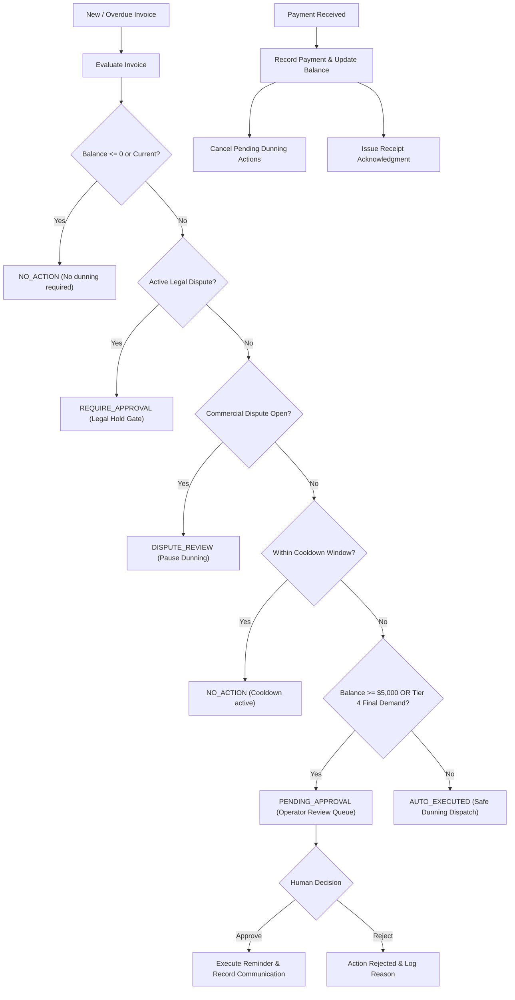

# CashHound 🐕💰
### Autonomous SMB Revenue Recovery Agent

CashHound is a specialized, zero-dependency autonomous accounts receivable agent designed for small-to-medium businesses (SMBs). It identifies unpaid invoices, calculates recovery priorities, generates polite-to-firm communications with tone controls, enforces human approval guardrails for high-value and legal accounts, and reconciles payments in real time.

---

## 🌟 Key Capabilities

1. **Intelligent Aging & Dynamic Priority Scoring:**
   - Categorizes receivables across aging brackets: `current` (<= 0 days), `30+` (1-30 days), `60+` (31-60 days), and `90+` (61+ days).
   - Priority scoring engine evaluates overdue days, exposure balance, customer relationship tier (`standard`, `vip`, `at_risk`), and active disputes.

2. **Tiered Polite-to-Firm Dunning Engine:**
   - **Tier 1 (1–14 days):** Friendly courtesy check-in and subtle reminder.
   - **Tier 2 (15–30 days):** Professional follow-up inquiry with clear payment links.
   - **Tier 3 (31–60 days):** Firm notice with pre-approved installment plan schedules.
   - **Tier 4 (61+ days):** Formal final demand with lump-sum settlement discount options.
   - **Tone Controls:** Automatically adapts tone (`friendly`, `professional`, `urgent`, `formal`, `empathetic`), preserving VIP customer relationships with concierge care.

3. **Financial Calculators:**
   - **Installment Payment Plan Generator:** Computes split payment schedules (weekly, bi-weekly, monthly) with transparent milestone breakdowns.
   - **Lump-Sum Settlement Offer Calculator:** Computes time-bounded settlement discounts (e.g. 15% off for payment within 7 days) to recover cash immediately.

4. **Safety & Governance Guardrails (Human-in-the-Loop):**
   - **High-Value Account Gate:** Any invoice balance $\ge$ $5,000 is automatically held in a pending approvals queue for human sign-off before sending.
   - **Legal Dispute Hold:** Invoices flagged with legal action or attorney involvement halt automated dunning and escalate directly to human legal review.
   - **Commercial Dispute Routing:** Pauses collection efforts while customer billing disputes are under investigation.
   - **Anti-Spam Cooldown:** Configurable cooldown period (default 7 days) prevents over-contacting clients.
   - **Autonomous Safe Execution:** Invoices below the high-value threshold without active disputes are automatically drafted and sent.

5. **Instant Payment Reconciliation:**
   - Automatically applies incoming payments (ACH, card, wire, check).
   - Updates invoice balance and status (`paid`, `partially_paid`).
   - Cancels pending dunning actions automatically.
   - Emits a branded, polite payment receipt acknowledgment.

6. **Auditable Decision Log:**
   - Chronological, tamper-evident audit trail of every automated decision, approval, rejection, and payment event.

---

## 🏗️ Architecture & Decision Flow



---

## 🚀 Quick Start

### Installation

CashHound is built with pure Node.js ES modules and has **zero external runtime dependencies**:

```bash
cd CashHound
npm test
```

### Usage Example

```javascript
import {
  Invoice,
  CashHoundAgent,
  CustomerTier,
  DunningTier,
  generateDunningMessage,
  calculateInstallmentPlan,
} from './src/index.js';

// 1. Initialize CashHound Agent with governance policies
const agent = new CashHoundAgent({
  highValueThreshold: 5000, // Accounts >= $5,000 require human review
  cooldownDays: 7,          // 7-day cooldown between communications
  autoSendSafeReminders: true,
});

// 2. Register Invoices
const invoice1 = new Invoice({
  id: 'INV-2024-001',
  customer: {
    name: 'Acme Hardware',
    email: 'accounts@acmehardware.com',
    tier: CustomerTier.STANDARD,
  },
  amount: 1250.00,
  dueDate: '2026-10-15', // Overdue
});

const highValueInvoice = new Invoice({
  id: 'INV-2024-002',
  customer: {
    name: 'Global Tech Industries',
    email: 'finance@globaltech.com',
    tier: CustomerTier.VIP,
  },
  amount: 8500.00,
  dueDate: '2026-10-10', // Overdue high-value
});

agent.registerInvoice(invoice1);
agent.registerInvoice(highValueInvoice);

// 3. Process Invoices
// Safe invoice (< $5,000) is automatically executed:
const action1 = agent.processInvoice(invoice1);
console.log(action1.status); // 'AUTO_EXECUTED'

// High-value invoice (>= $5,000) is held for approval:
const action2 = agent.processInvoice(highValueInvoice);
console.log(action2.status); // 'PENDING_APPROVAL'
console.log(action2.approvalReasons);
// ['High-value invoice balance ($8,500 >= $5,000)']

// 4. Human-in-the-Loop Review
const pendingList = agent.getPendingApprovals();
console.log(`Pending approvals: ${pendingList.length}`);

// Approve action:
agent.approveAction(action2.id, {
  name: 'Jane Doe',
  notes: 'Spoke with CFO; verified terms. Approved to send.',
});

// 5. Payment Reconciliation
agent.recordPayment('INV-2024-001', {
  amount: 1250.00,
  method: 'ach',
  reference: 'ACH-789123',
});

console.log(invoice1.status); // 'paid'
console.log(invoice1.balance); // 0
```

---

## 🧪 Testing

CashHound uses the native Node.js test runner (`node:test`) and strict assertions (`node:assert`):

```bash
npm test
```

### Test Coverage Highlights:
- **Aging Engine:** Strict verification of `current`, `30+`, `60+`, and `90+` day brackets.
- **Tone & Dunning:** Courtesy, reminder, urgent notices, VIP preservation, installment schedules, and settlement calculations.
- **Safety Gates:** Validation of $\ge \$5,000$ high-value threshold and legal dispute isolation.
- **State Machine:** Automated approval workflows, action rejections, cooldown enforcement.
- **Reconciliation:** Partial and full payments, auto-cancellation of pending actions, and receipt generation.
- **Batch Processing:** Complete multi-account portfolio cycle evaluation.

---

## 📄 License

MIT
