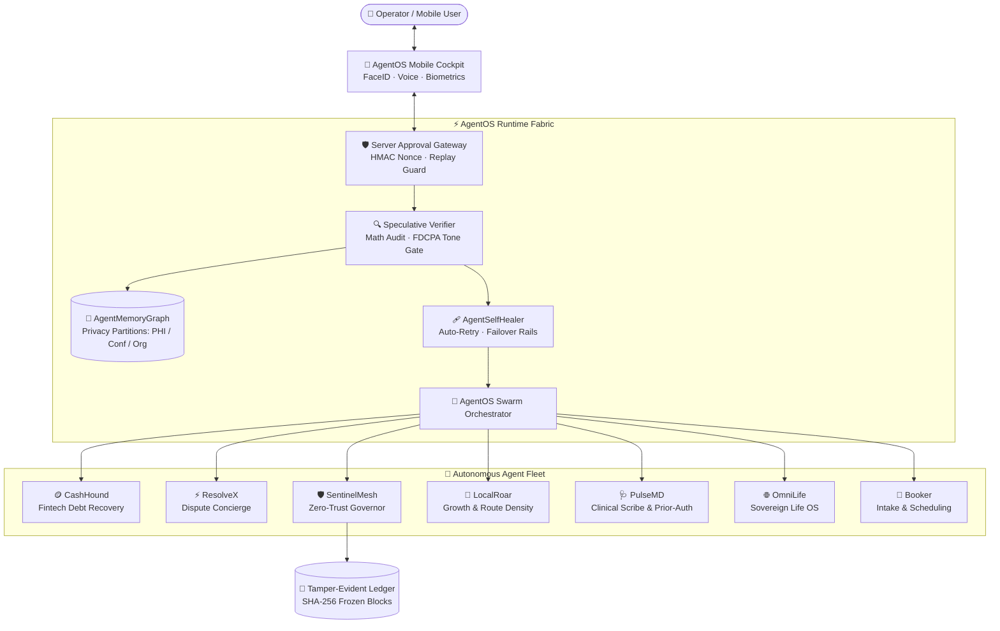

# ⚡ AgentOS — The Autonomous Agent Operating System

[](https://spekra.in)
[](https://github.com/subash-thiruppathi/agent-os/actions)
[](https://github.com/subash-thiruppathi/agent-os)
[](https://nodejs.org/)
[](https://opensource.org/licenses/MIT)
[](https://github.com/subash-thiruppathi/agent-os)

**AgentOS** is an outcome-driven, production-grade operating system for autonomous AI agents, engineered under the **[Spekra](https://spekra.in)** autonomous intelligence and operational reliability ecosystem. It combines a zero-trust governance fabric, speculative action verifiers, cross-agent memory graphs, auto-healing execution rails, and a native mobile command cockpit for real-time human oversight.

---

## 🏛️ System Architecture



---

## 🚀 The 6 Core Platform Engines

### 1. 🧠 Cross-Agent Memory Graph (`AgentMemoryGraph`)
- Cross-agent semantic facts with **cryptographic privacy tiers**: `PUBLIC`, `ORGANIZATION`, `CONFIDENTIAL`, and `RESTRICTED_PHI`.
- Hard boundaries prevent medical facts from leaking into commercial dunning bots.
- Automatically supersedes outdated records with higher-confidence observations.

### 2. 🩹 Self-Healing & Auto-Recovery (`AgentSelfHealer`)
- Automated fault classification: `429 Rate Limit`, `TRANSIENT_NETWORK`, `RAIL_UNAVAILABLE`, `AUTH_EXPIRED`.
- Intelligent exponential jittered backoff without dropping active agent tasks.
- Hot failover switching from primary rails (e.g. Stripe) to secondary rails (e.g. Adyen).

### 3. 🔍 Speculative Verifier ("Second Pair of Eyes") (`SpeculativeVerifier`)
- Audits proposed actions **before** human operator presentation.
- Verifies exact minor-unit (cents) integer math reconciliations across line items.
- Scans outbound messages for prohibited coercion words (FDCPA debt collection compliance).

### 4. 🐝 Cross-Agent Swarm Orchestrator (`AgentOSSwarm`)
- Pipelines complex multi-stage tasks across specialized agents:
  `LocalRoar (Lead)` $\rightarrow$ `Booker (Intake)` $\rightarrow$ `Sidekick (Quote)` $\rightarrow$ `Clerk (Invoice)` $\rightarrow$ `SentinelMesh (Security Gate)`.

### 5. 🔐 Biometric Hardware Authorization (`BiometricController`)
- Hardware-backed challenge-nonce generation prevents man-in-the-middle replays.
- Gates high-value transactions (> $1,000) behind FaceID / TouchID biometric signatures.

### 6. 🎙️ Voice Cockpit Engine (`VoiceCockpit`)
- Hands-free natural language command interpretation.
- Parses intents, verifies authority levels, executes agent tasks, and streams synthesized audio responses.

---

## 🤖 The Autonomous Agent Fleet

| Agent | Domain | Highlights |
| :--- | :--- | :--- |
| **🪙 CashHound** | B2B Working Capital & Recovery | Discounted Cash Flow NPV optimizer, ACH memo reconciler, respectful dunning tiers. |
| **⚡ ResolveX** | E-Commerce Dispute Concierge | Computer vision damage assessor (94.2% auto-resolution), carrier delay listener, SHA-256 idempotency refund replay guard. |
| **🛡️ SentinelMesh** | Zero-Trust Governance | Least-privilege sandboxing, immutable SHA-256 ledger blocks, dual-control high-value gates, emergency quarantine killswitch. |
| **📣 LocalRoar** | 24/7 Local Business Growth | SMS/WhatsApp intake, route-density proximity match (10–15% neighborhood discounts), 1–3 star private review interceptor. |
| **🩺 PulseMD** | Clinical Charting & Prior-Auth | Ambient dialogue extractor into FHIR SOAP notes, automatic PHI redaction (SSN, phone, email), drug-allergy contraindication guard. |
| **🌐 OmniLife** | Sovereign Life OS | Telecom bill negotiator battlecards, retention maze cancellation graph, passport 6-month international travel checker. |
| **📅 Booker** | Autonomous Scheduling | Unstructured intake parsing, double-booking prevention, calendar sync. |

---

## 💻 Quickstart

### 1. Clone & Install
```bash
git clone https://github.com/subash-thiruppathi/agent-os.git
cd agent-os
```

### 2. Start the Unified Fleet Server & Dashboard
```bash
npm start
```
Open **`http://localhost:3000`** in your browser to access the live fleet control room.

### 3. Launch Mobile Cockpit
```bash
npm run mobile
```
Press `i` for iOS Simulator, `a` for Android Emulator, or scan the QR code with the Expo Go app.

### 4. Run Test Suite (98/98 Tests Passing)
```bash
npm test
```

---

## 🔌 REST API Endpoints

| Method | Endpoint | Description |
| :--- | :--- | :--- |
| `GET` | `/api/status` | Returns live health, uptime, and pending approvals for all agents. |
| `GET` | `/api/fleet/stream` | Real-time Server-Sent Events (SSE) telemetry stream to Spekra cloud and mobile cockpit. |
| `GET` | `/api/spekra/status` | Returns Spekra.in connectivity state, trace spans, and mirrored audit blocks snapshot. |
| `GET` | `/api/memory/query?caller={agent}&entity={id}` | Queries privacy-partitioned facts from the cross-agent memory graph. |
| `POST` | `/api/memory/record` | Ingests a validated semantic fact into the memory graph. |
| `POST` | `/api/self-heal/test` | Triggers a simulated 429 fault and auto-heals over secondary rails. |
| `POST` | `/api/verifier/audit` | Audits proposed agent actions for exact math breakdown and tone safety. |
| `POST` | `/api/cashhound/cycle` | Executes automated dunning and NPV debt recovery batch cycle. |
| `POST` | `/api/resolvex/resolve` | Auto-resolves customer support cases and processes idempotent refunds. |
| `POST` | `/api/localroar/inquiry` | Ingests SMS lead, verifies route density, and calculates instant quotes. |
| `POST` | `/api/pulsemd/encounter` | Scribes doctor-patient encounter, auto-masks PHI, and drafts SOAP note. |
| `GET` | `/api/omnilife/audit` | Scans subscriptions for dormant fees and checks passport validity. |
| `POST` | `/api/sentinel/killswitch` | Administrator emergency kill-switch to quarantine agent actions. |

---

## 🛡️ Security & Privacy Architecture

- **Zero Untrusted Execution:** Agents evaluate strictly structured schemas; raw string inputs are never passed to execution rails.
- **Server-Authoritative Tokens:** Client devices generate cryptographically signed nonces verified by `ServerApprovalGateway`.
- **PHI / PII Sanitization:** SSNs, credit cards, emails, and phone numbers are automatically redacted before entering shared agent memory.
- **Tamper-Evident Ledger:** Every agent state change is recorded into a linked SHA-256 block ledger with frozen immutability.

---

## 📄 License
MIT © [Subash Thiruppathy](https://github.com/subash-thiruppathi)
